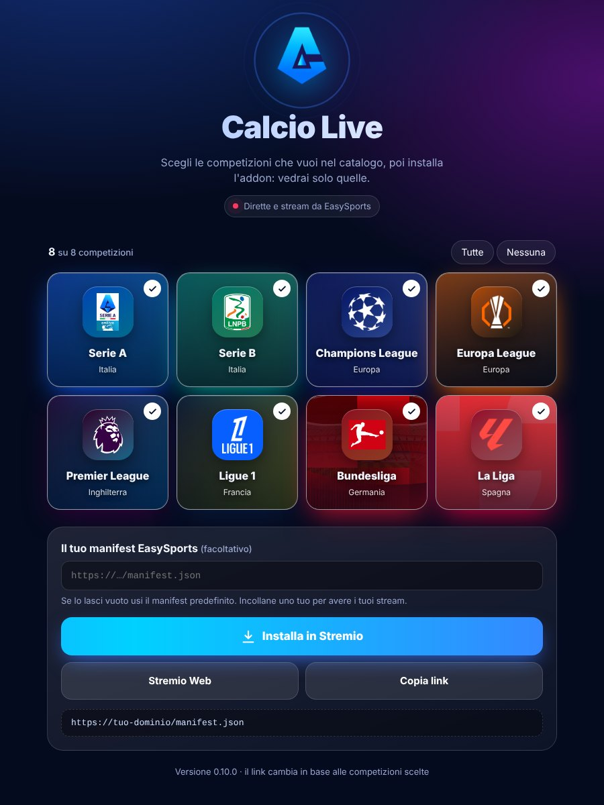
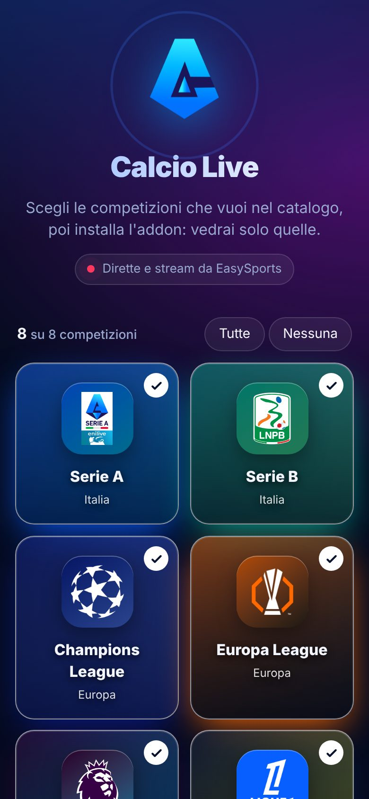
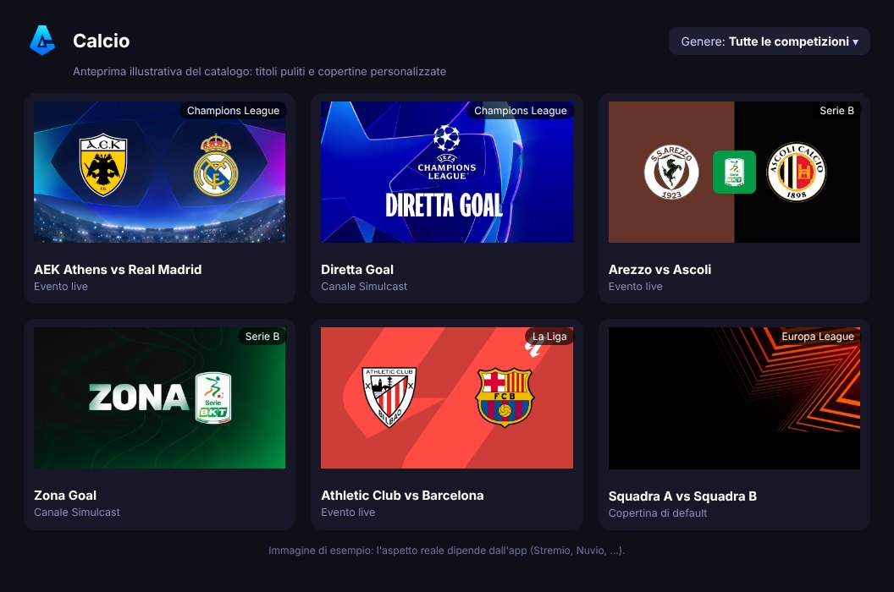
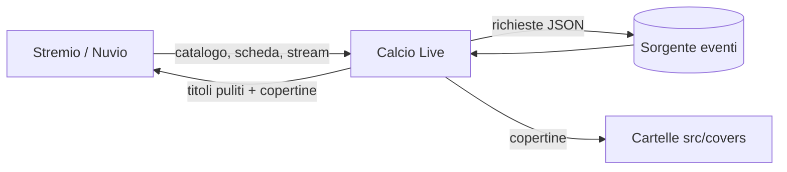

# ⚽ Calcio Live — addon per Stremio

Un addon per **Stremio** (e app compatibili come Nuvio) che mostra un **unico catalogo di calcio** con le competizioni che scegli tu, con titoli puliti, copertine personalizzate e canali "Simulcast" già riconoscibili.

> Gli stream non sono ospitati qui: l'addon è un **ponte** che prende gli eventi da un servizio sorgente (EasySports), li ripulisce, li rende più belli e li inoltra a Stremio.

## Anteprime

**Pagina di configurazione** — scegli le competizioni e installa l'addon:

<p align="center">
  
  &nbsp;
  
</p>

**Catalogo in app** — titoli senza prefissi e bandiere, copertine dedicate, canali Simulcast:

<p align="center">
  
</p>

_Le immagini sono esempi illustrativi: l'aspetto reale dipende dall'app che usi. Alcuni sfondi delle card nella pagina di configurazione sono immagini esterne e possono non comparire nelle anteprime._

## Cosa fa

| Funzione | Descrizione |
| --- | --- |
| **Catalogo unico** | Un solo catalogo, `Calcio`, con filtro **genere** per scegliere la competizione. |
| **8 competizioni** | Serie A, Serie B, Champions League, Europa League, Premier League, Ligue 1, Bundesliga, La Liga. |
| **Titoli puliti** | Da `⚽ UEFA Champions League : AEK Athens 🇬🇷 vs Real Madrid 🇪🇸` a **AEK Athens vs Real Madrid**. |
| **Copertine personalizzate** | Una copertina 16:9 per partita, mantenuta anche nella schermata delle fonti. |
| **Canali Simulcast** | Gli eventi "Simulcast" diventano **Diretta Goal** (Serie A, Champions, Europa League) o **Zona Goal** (Serie B), con la loro immagine. |
| **Pagina di configurazione** | Scegli le competizioni, vedi il link di installazione aggiornato in tempo reale. |
| **Manifest personale** | Chi vuole può usare il proprio accesso alla sorgente invece di quello predefinito. |

### Come funziona



1. Stremio chiede il catalogo; l'addon legge gli eventi dalla sorgente (con una piccola cache di circa 30 secondi).
2. Tiene solo le competizioni scelte e riconosce la lega dal titolo (`Paese - Lega :`).
3. Ripulisce il titolo e abbina la copertina giusta, se esiste.
4. Per scheda evento e stream inoltra la richiesta alla sorgente, ma con ID propri (`seriea:…`) così Stremio non passa da altri addon che sovrascriverebbero la copertina.

## Installazione

1. Apri la pagina `https://TUO-DOMINIO/configure`.
2. Spunta le competizioni che vuoi.
3. Premi **Installa in Stremio** (oppure *Copia link* e incolla il link nella sezione addon dell'app).

Il link cambia in base alle scelte: `…/manifest.json` per tutte le competizioni, `…/cfg/serie-a,la-liga/manifest.json` per una selezione. Nel catalogo il menu **Genere** permette poi di filtrare ancora.

### Manifest personale (facoltativo)

Nella pagina di configurazione c'è il campo **Il tuo manifest EasySports**. Se lo lasci vuoto si usa quello predefinito; se ne incolli uno tuo viene incluso nel link di installazione e gli stream arrivano dal tuo accesso. Sono accettati solo manifest del servizio previsto (`https`, nessun altro host o parametro).

> ⚠️ Il link di installazione con manifest personale contiene il tuo accesso: non condividerlo.

## Competizioni e riconoscimento

Il riconoscimento è **stretto** e si basa sul titolo dell'evento (`Paese - Lega :`, trattino facoltativo).

| Competizione | Titolo atteso (esempio) |
| --- | --- |
| Serie A / Serie B | `Italy - Serie A :` / `Italy Serie B :` |
| Champions League | `UEFA Champions League :` |
| Europa League | `UEFA Europa League :` |
| Premier League | `England - Premier League :` |
| Ligue 1 | `France - Ligue 1 :` |
| Bundesliga | `Germany - Bundesliga :` |
| La Liga | `Spain - La Liga :` |

Restano **fuori**: Serie C, La Liga 2, Bundesliga austriaca, AFC/CAF Champions League, Conference League e le competizioni femminili. Se un titolo reale è scritto in modo diverso, basta correggere la voce corrispondente in `LEAGUES` (`src/server.js`).

## Copertine

Ogni competizione ha la sua cartella in `src/covers/`:

```
src/covers/
├── serie-b/  champions/  europa/
├── premier-league/  ligue-1/  bundesliga/  la-liga/
```

- Formato file: `squadra-casa_vs_squadra-ospite.png` (anche `.webp` o `.jpg`), minuscolo e con i trattini, es. `real-madrid_vs_barcelona.png`.
- I nomi delle squadre vengono abbinati anche se scritti in modo leggermente diverso (sigle come FC/CF, accenti, alias comuni).
- `default.png` (o `.webp`/`.jpg`) è facoltativa: viene usata per le partite senza copertina dedicata.
- Senza file né default resta la copertina originale.
- Dopo aver aggiunto immagini serve un nuovo deploy.

I canali **Simulcast** hanno le loro immagini in `src/assets/simulcast/`, separate dalle cartelle delle partite.

## Pagina di configurazione e grafica

La pagina (`src/configure.html`) ha una scheda per competizione con colori e sfondo a tema, animazioni e un riquadro che mostra il link di installazione. I colori e gli stemmi si trovano in `src/league-art.js`; per usare i **loghi ufficiali** metti i file in `src/assets/leagues/` (`serie-a.png`, `la-liga.svg`, …) e la pagina li userà al posto degli stemmi disegnati.

## Privacy e traffico

- L'addon **non fa scraping di pagine web**: usa gli stessi endpoint JSON di un normale client Stremio.
- Il catalogo viene richiesto alla sorgente al massimo una volta ogni 30 secondi (configurabile), indipendentemente dal numero di utenti. Scheda evento e stream sono richiesti solo quando un utente li apre.
- La sorgente vede l'indirizzo del **server dell'addon**, non quello dei singoli utenti: gli IP degli utenti non vengono inoltrati.
- L'addon si presenta con uno User-Agent dichiarato, non finge di essere un'app.
- Usare un servizio come proxy per più persone può non essere consentito dai suoi termini: controllali prima di condividere pubblicamente l'addon.

## Installazione sul proprio server

Serve Node.js 20 o superiore (o Docker).

```bash
npm install
npm start          # http://localhost:7000
```

Con Docker (`Dockerfile` incluso): esponi la porta `7000` e imposta le variabili che ti servono.

| Variabile | Predefinito | Significato |
| --- | --- | --- |
| `PORT` | `7000` | Porta HTTP. |
| `PUBLIC_BASE_URL` | dedotto dalla richiesta | URL pubblico HTTPS del servizio (utile dietro proxy). |
| `CACHE_TTL_MS` | `30000` | Durata della cache del catalogo. |
| `REQUEST_TIMEOUT_MS` | `12000` | Timeout delle richieste verso la sorgente. |
| `COVERS_DIR` | `src/covers` | Cartella delle copertine (per test o percorsi diversi). |

Controlli rapidi: `/health` (stato e versione), `/manifest.json`, `/configure`.

## Test e prove

```bash
npm test          # test automatici con una sorgente finta (nessuna rete)
npm run demo      # avvia l'addon con eventi finti per provarlo a mano
npm run verify    # con l'addon online: controlla che i link di catalogo e scheda coincidano e rispondano
```

Per provare titoli veri: crea un file `miei-eventi.json` con `[{"id":"soccer:1","name":"⚽ UEFA Champions League : AEK Athens 🇬🇷 vs Real Madrid 🇪🇸"}]` e avvia con `MOCK_EVENTS_FILE=miei-eventi.json npm run demo`.

## Struttura del progetto

```
src/server.js         addon: manifest, cataloghi, scheda, stream, configurazione
src/configure.html    pagina di configurazione
src/league-art.js     colori, sfondi e stemmi delle competizioni
src/covers/           copertine delle partite, una cartella per competizione
src/assets/           logo dell'addon, loghi competizioni, immagini Simulcast
test/                 test automatici e sorgente finta
docs/                 anteprime usate in questo README
```
